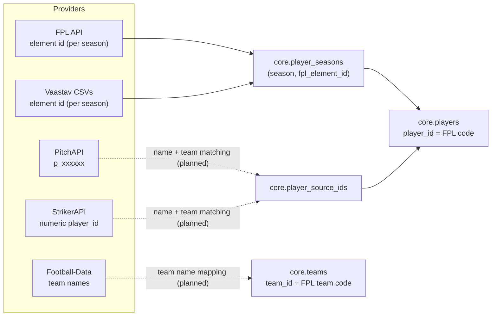

# Database schema

This page describes the Phase 1 warehouse: how the tables relate and what each one holds. The source of truth is [`sql/001_init.sql`](../sql/001_init.sql).

- **raw** stores provider data exactly as received, plus a log of every HTTP request.
- **core** stores standardised entities keyed on canonical IDs.
- **ops** stores the run history of every ingestion job.
- **features** and **predictions** are reserved for later phases.

In the diagram, `raw_*` tables live in the `raw` schema, `ops_*` tables in `ops`, and every other table in `core`. Solid lines are enforced foreign keys. Dotted lines are joins on natural keys that the database doesn't enforce.

```mermaid
erDiagram
    %% ---------- core: reference entities ----------
    seasons {
        text season PK "e.g. 2026-27"
        int start_year
        bool is_current
    }
    teams {
        int team_id PK "FPL team code (stable across seasons)"
        text team_name
        text short_name
    }
    team_seasons {
        text season PK, FK
        int fpl_team_id PK "1-20, changes per season"
        int team_id FK
        int strength_attack_home
        int strength_defence_away
    }
    players {
        int player_id PK "FPL element code (stable across seasons)"
        text web_name
        text position "latest"
        int team_id FK "latest"
        date date_of_birth
        numeric current_price
        numeric ownership
    }
    player_seasons {
        text season PK, FK
        int fpl_element_id PK "changes per season"
        int player_id FK
        int team_id FK
        text position
        numeric start_price
    }
    player_source_ids {
        bigint id PK
        int canonical_player_id FK
        text source_name "fpl_element, opta, pitchapi, ..."
        text source_player_id
        text season
        text match_method
    }
    gameweeks {
        text season PK, FK
        int gameweek PK
        timestamptz deadline_time
        bool finished
        bool is_current
    }
    fixtures {
        bigint fixture_id PK
        text season FK
        int fpl_fixture_id "unique per season"
        int gameweek
        int home_team_id FK
        int away_team_id FK
        timestamptz kickoff_time
        int home_score
        int away_score
        int official_home_fdr
        int official_away_fdr
    }

    %% ---------- core: facts ----------
    player_match_stats {
        bigint id PK
        int player_id FK "unique with fixture_id"
        bigint fixture_id FK
        int team_id FK
        int opponent_team_id FK
        int minutes
        int goals
        int assists
        numeric expected_goals
        numeric expected_assists
        int defensive_contribution
        int bps
        int fpl_points
        numeric price
        text source "fpl_api or vaastav"
    }
    player_season_history {
        int player_id PK, FK
        text season PK
        int total_points
        int minutes
        jsonb data
    }
    player_price_history {
        bigint id PK
        int player_id FK
        numeric price
        numeric ownership
        int transfers_in_event
        timestamptz observed_at "append-only"
        bigint snapshot_id FK
    }
    player_availability {
        bigint id PK
        int player_id FK
        text source
        text injury_status
        int chance_of_playing_next_round
        text news
        date expected_return_date
        timestamptz observed_at "append-only, on change"
        bigint snapshot_id FK
    }
    lineups {
        bigint id PK
        bigint fixture_id FK
        int player_id FK
        bool is_starting
        bool lineup_confirmed
        text source
    }

    %% ---------- raw ----------
    raw_source_snapshots {
        bigint id PK
        text source_name
        text endpoint
        timestamptz snapshot_timestamp
        int http_status
        bool success
        text content_sha256
        text archive_path "gzipped payload on disk"
    }
    raw_fpl_live_gameweek {
        text season PK
        int gameweek PK
        int fpl_element_id PK
        jsonb stats
        jsonb explain
        bigint snapshot_id FK
    }
    raw_football_data_matches {
        text season PK
        date match_date PK
        text home_team PK "provider name"
        text away_team PK "provider name"
        int fthg
        int ftag
        numeric home_xg
        jsonb data "full CSV row incl. odds"
        bigint snapshot_id FK
    }
    raw_provider_records {
        text source_name PK "pitchapi, strikerapi"
        text entity PK "match, match_shots, shot_map, ..."
        text entity_id PK
        text season
        jsonb payload
        bigint snapshot_id FK
    }

    %% ---------- ops ----------
    ops_ingestion_runs {
        bigint id PK
        text job
        timestamptz started_at
        text status "running, success, failed"
        int rows_written
        jsonb details
    }

    %% ---------- relationships (enforced) ----------
    seasons ||--o{ team_seasons : "has"
    seasons ||--o{ player_seasons : "has"
    seasons ||--o{ gameweeks : "has"
    seasons ||--o{ fixtures : "has"
    teams ||--o{ team_seasons : "plays in"
    teams ||--o{ player_seasons : "registers"
    teams |o--o{ players : "current club"
    teams ||--o{ fixtures : "home / away"
    players ||--o{ player_seasons : "per season"
    players ||--o{ player_source_ids : "known as"
    players ||--o{ player_match_stats : "plays"
    players ||--o{ player_season_history : "season totals"
    players ||--o{ player_price_history : "priced"
    players ||--o{ player_availability : "status"
    players ||--o{ lineups : "selected"
    fixtures ||--o{ player_match_stats : "produces"
    fixtures ||--o{ lineups : "has"
    teams ||--o{ player_match_stats : "team / opponent"
    raw_source_snapshots ||--o{ player_price_history : "observed in"
    raw_source_snapshots ||--o{ player_availability : "observed in"
    raw_source_snapshots ||--o{ raw_fpl_live_gameweek : "observed in"
    raw_source_snapshots ||--o{ raw_football_data_matches : "observed in"
    raw_source_snapshots ||--o{ raw_provider_records : "observed in"

    %% ---------- relationships (logical, not enforced) ----------
    gameweeks ||..o{ fixtures : "season + gameweek"
    player_seasons ||..o{ raw_fpl_live_gameweek : "season + fpl_element_id"
    player_source_ids ||..o{ raw_provider_records : "provider player id (planned)"
```

## How the IDs fit together

## Table guide

| Table | Grain | Written by | Notes |
|---|---|---|---|
| `core.seasons` | season | FPL API, Vaastav | `is_current` marks the live season |
| `core.teams` | club | FPL API, Vaastav | `team_id` is FPL's stable team `code` (3 = Arsenal) |
| `core.team_seasons` | club × season | FPL API, Vaastav | Maps the season-specific 1–20 team ID to `team_id`; includes FPL strength ratings |
| `core.players` | player | FPL API, Vaastav | `player_id` is FPL's stable element `code`; holds the latest known attributes |
| `core.player_seasons` | player × season | FPL API, Vaastav | Maps the season-specific element ID to `player_id`; holds position and club that season |
| `core.player_source_ids` | player × provider ID | all sources | Cross-provider identity map |
| `core.gameweeks` | season × GW | FPL API, Vaastav | Deadlines are only available for the live season |
| `core.fixtures` | match | FPL API, Vaastav | Unique on (`season`, `fpl_fixture_id`); official FDR included |
| `core.player_match_stats` | player × fixture | FPL API, Vaastav | One row per fixture, so a double gameweek gives two rows. NULL = not published that season |
| `core.player_season_history` | player × season | FPL API | Season totals from `element-summary.history_past` |
| `core.player_price_history` | observation | FPL API | Append-only; one row per player per 6-hourly sync |
| `core.player_availability` | observation | FPL API | Append-only; a new row only when status or news changes |
| `core.lineups` | player × fixture | (planned: PitchAPI) | Predicted and confirmed lineups |
| `raw.source_snapshots` | HTTP request | every source | Payload archived gzipped and content-addressed on disk |
| `raw.fpl_live_gameweek` | player × GW | FPL API | Latest live stats during matches |
| `raw.football_data_matches` | match | Football-Data.co.uk | Results, shots, cards, corners, odds, team xG |
| `raw.provider_records` | provider entity | PitchAPI, StrikerAPI | JSON payloads (shots, player stats, lineups, shot maps) waiting to be promoted to typed tables |
| `ops.ingestion_runs` | job run | every job | Status, row counts and errors; drives the freshness report |

Views: `core.player_defensive_stats`, `core.goalkeeper_stats` and `core.v_latest_availability`.
